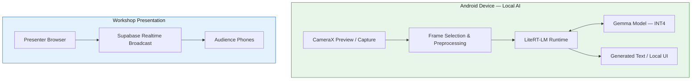

# Edge AI on Android: Running Local Gemma 4 & Gemini Nano with LiteRT

<p align="center">
  <strong>🚀 Bringing Generative AI to the Edge — Private, Responsive, and Offline-Capable.</strong>
</p>

<p align="center">
  A hands-on Android AI workshop exploring on-device inference, real-time camera intelligence, model quantization, and synchronized developer presentations — powered by LiteRT-LM and Google's on-device AI ecosystem.
</p>

<p align="center">
  <a href="https://developer.android.com/"></a>
  <a href="https://ai.google.dev/gemma"></a>
  <a href="https://ai.google.dev/edge/litert"></a>
  <a href="https://developers.google.com/community/gdg"></a>
</p>

<p align="center">
  <a href="#-quick-start">Quick Start</a> •
  <a href="#-architecture">Architecture</a> •
  <a href="#-performance-optimization">Performance</a> •
  <a href="#-live-presentation--slide-synchronization">Live Slides</a> •
  <a href="#-contributing">Contributing</a>
</p>

---

## 📌 Project Overview

**Edge AI on Android** is a practical exploration of running generative AI directly on Android hardware, without depending on a remote inference API for the core model execution.

This repository brings together two complementary workshop experiences:

1. **On-device AI application:** An Android application combining CameraX, LiteRT-LM, and a locally stored, INT4-quantized Gemma model for camera-assisted AI workflows.
2. **Live workshop presentation:** A web-based slide deck with Supabase Realtime Broadcast synchronization, allowing audience members to follow the presenter's slides from their own phones.

The workshop demonstrates how edge AI can move inference closer to users — reducing network dependence, keeping supported processing on-device, and enabling AI experiences in environments with limited or unreliable connectivity.

### 🎯 Workshop goals

- Run a local Gemma model on real, mid-tier Android hardware.
- Connect camera input to a local generative AI inference pipeline.
- Explore quantization and CPU inference optimization.
- Understand memory constraints and performance trade-offs on mobile devices.
- Synchronize a web presentation across audience devices using Supabase Realtime.
- Compare general-purpose open-weight models with Android's Gemini Nano ecosystem.

### 🧪 Reference hardware

| Component | Reference configuration |
|---|---|
| Test device | Redmi Pad 2 |
| Chipset | MediaTek Helio G100-Ultra |
| AI runtime | LiteRT-LM |
| Model family | Gemma |
| Model configuration | Gemma 4 E2B, INT4 quantized |
| Camera integration | Android CameraX |
| Inference target | Local device execution |
| Connectivity | Internet not required for local inference after setup |

> **Compatibility note:** The configuration above describes the workshop's reference setup, not a guarantee that every Android device supports the same model, runtime, or performance profile. Verify model compatibility, memory requirements, and runtime support before deploying to other devices.

---

## ✨ Key Technical Highlights

### 📱 1. Local-first AI inference

The model runs on the Android device through LiteRT-LM instead of sending each inference request to a cloud-hosted model endpoint.

- No cloud inference round trip for supported local tasks.
- No per-request internet dependency once the app, runtime, and model are installed.
- Better control over camera data and inference inputs.
- Potentially lower interaction latency when the device can execute the workload efficiently.

**Important:** First-time downloads, dependency resolution, model acquisition, and any external services still require connectivity when applicable. The architecture is offline-capable, not automatically air-gapped.

### 🧠 2. INT4 model quantization

Quantization reduces model weight precision from FP32 to a lower-bit representation, helping make local inference more practical on memory-constrained devices.

| Property | FP32 baseline | INT4 target |
|---|---:|---:|
| Weight precision | 32 bits | 4 bits |
| Idealized weight storage | 4 bytes/parameter | 0.5 bytes/parameter |
| Relative raw weight storage | 1× | 1/8× |
| Runtime overhead | Depends on execution path | Depends on kernels and format |
| Accuracy | Baseline reference | Requires evaluation |

The idealized weight-storage reduction is approximately **87.5%**, before accounting for quantization metadata, alignment, runtime buffers, activations, and other overhead.

> **Quantization is not a universal speed guarantee.** Actual memory use, throughput, and output quality depend on the model format, quantization scheme, hardware, and runtime implementation. Use a compatible pre-quantized artifact or a documented conversion pipeline rather than simply changing a model's file extension.

### ⚡ 3. CPU inference optimization with XNNPACK

Where supported by the selected LiteRT-LM execution path, optimized CPU kernels can improve inference efficiency on Android processors.

Optimization areas include:

- Selecting an appropriate CPU thread count.
- Avoiding excessive thread creation and contention.
- Measuring prompt-processing and token-generation latency separately.
- Balancing throughput against battery use and thermal throttling.
- Verifying that the chosen runtime and model configuration actually use the intended backend.

**Implementation note:** XNNPACK support and configuration depend on the exact runtime integration. Confirm that the selected LiteRT-LM build exposes the relevant backend settings before applying backend-specific configuration.

### 🛡️ 4. Memory-aware generation

Budget and mid-tier Android devices have finite memory budgets shared by the operating system, camera buffers, model weights, activations, and application code.

This project emphasizes:

- Capping generated output tokens.
- Avoiding unnecessarily long prompts.
- Processing only the image data required for the task.
- Releasing camera and inference resources when no longer needed.
- Testing repeated inference rather than relying on a single successful run.

Token limits help bound generation-related memory and execution time, but they do **not** guarantee protection against out-of-memory errors. Model loading, context size, image preprocessing, and runtime allocations must also be controlled.

### 📡 5. Live slide synchronization

The presentation companion uses Supabase Realtime Broadcast to propagate slide changes from the presenter to connected audience devices.

- Presenter-driven slide navigation.
- Browser-based audience access.
- Low-latency event delivery over WebSockets.
- No requirement to install a companion app just to view the slides.

The presentation synchronization service is separate from the local AI inference pipeline. Internet access is normally required for hosted presentation access and Supabase connectivity.

---

## 🏗️ Architecture

### System overview



The two subsystems serve different purposes: the Android application executes inference locally, while the presentation service synchronizes workshop slides over the network.

### Android inference pipeline

```text
Camera Sensor
     │
     ▼
CameraX ImageAnalysis / Capture
     │
     ▼
Frame Selection + Image Preprocessing
     │
     ▼
Prompt / Multimodal Input Construction
     │
     ▼
LiteRT-LM Inference Runtime
     │
     ▼
Locally Loaded Gemma Model (INT4)
     │
     ▼
Generated Response
     │
     ▼
Android UI
```

**Pipeline responsibilities**

| Layer | Responsibility |
|---|---|
| CameraX | Camera lifecycle, preview, and frame acquisition |
| Preprocessing | Frame selection, resizing, and supported input conversion |
| Input construction | Creates the prompt and model-compatible input representation |
| LiteRT-LM | Loads and executes the model through a supported runtime backend |
| Gemma | Generates a response using the capabilities of the selected model |
| Android UI | Displays inference results and communicates loading or error states |

**Multimodal compatibility matters:** CameraX supplies image data, but a text-only language model cannot interpret raw image pixels by itself. The application must use a vision-capable model and a supported image-input path, or transform the image into a representation the selected model can consume. Verify the exact Gemma variant and LiteRT-LM APIs used in this repository.

### Presentation synchronization pipeline

```text
Presenter Navigates to a Slide
              │
              ▼
       Presenter Web App
              │
              ▼
 Supabase Realtime Broadcast Event
              │
       ┌──────┴──────┐
       ▼             ▼
 Audience Phone A  Audience Phone B
       │             │
       ▼             ▼
  Updated Slide  Updated Slide
```

Use a dedicated broadcast channel for the presentation session. Validate incoming events, handle reconnects, and ensure that audience clients can recover the current slide after joining late.

---

## 🧰 Technology Stack

| Technology | Role |
|---|---|
| Kotlin / Android | Native application development |
| CameraX | Camera preview and frame acquisition |
| LiteRT-LM | On-device generative AI inference |
| Gemma | Locally executed open-weight model |
| INT4 quantization | Reduced model weight storage |
| XNNPACK, where supported | Optimized CPU execution |
| Android Studio | Build, debugging, and profiling |
| Web technologies | Browser-based presentation |
| Supabase Realtime | Live slide-state broadcasting |
| WebSockets | Persistent real-time event transport |

### Gemma vs. Gemini Nano

These technologies are related to on-device AI, but they are not interchangeable.

| Capability | Local Gemma with LiteRT-LM | Gemini Nano |
|---|---|---|
| Model delivery | Application-managed compatible model artifact | Google-supported on-device delivery and integration path |
| Runtime | LiteRT-LM, for supported model configurations | Android's supported Gemini Nano integration, such as AICore where applicable |
| Device compatibility | Depends on model, runtime, memory, and backend | Depends on supported devices, APIs, and distribution requirements |
| Offline behavior | Can operate offline after setup if all required resources are local | Depends on the supported integration and availability of required resources |
| Primary workshop value | Exploring explicit model deployment and local inference | Understanding Google's managed on-device model ecosystem |

This workshop focuses on the locally managed Gemma path. Gemini Nano is included as a comparison point; it should not be interpreted as an interchangeable model file or an automatic fallback for LiteRT-LM.

---

## 📂 Repository Structure

The following layout is a suggested reference structure. Adjust paths to match the actual repository before publishing.

```text
edge-ai-android-workshop/
├── README.md
├── LICENSE
├── docs/
│   ├── architecture.md
│   ├── setup.md
│   └── performance.md
├── presentation/
│   ├── README.md
│   ├── package.json
│   ├── public/
│   └── src/
│       ├── components/
│       ├── slides/
│       └── lib/
│           └── supabase.ts
├── android/
│   ├── settings.gradle.kts
│   ├── build.gradle.kts
│   ├── gradle.properties
│   └── app/
│       ├── build.gradle.kts
│       └── src/
│           └── main/
│               ├── AndroidManifest.xml
│               ├── java/
│               │   └── ...
│               └── res/
└── .gitignore
```

### Folder guide

| Path | Purpose |
|---|---|
| `presentation/` | Browser-based workshop deck and presenter controls |
| `presentation/src/slides/` | Slide content and presentation components |
| `presentation/src/lib/` | Supabase client and synchronization logic |
| `android/` | Native Android project |
| `android/app/` | Application source, resources, and build configuration |
| `docs/` | Architecture, setup, and performance documentation |
| `LICENSE` | Repository licensing terms |
| `.gitignore` | Excludes local configuration, generated files, and model artifacts |

> The repository layout above is illustrative. Keep documentation aligned with the checked-in project structure and avoid committing large model binaries unless the repository's distribution and licensing arrangements explicitly support it.

---

## 🚀 Quick Start

Follow these steps to build the Android application and prepare the local model.

### Prerequisites

| Requirement | Notes |
|---|---|
| Android Studio | Install a current stable release compatible with the project's Gradle and Android Gradle Plugin versions |
| JDK | Use the version required by the project's Gradle wrapper and Android Gradle Plugin |
| Android SDK | Install the compile SDK specified by the project |
| Android device | Use a physical Android device for representative performance testing |
| USB debugging | Enable Developer options and USB debugging for direct installation |
| Model artifact | Obtain the exact compatible Gemma model and quantization format |
| Internet connection | Needed initially for dependencies, model acquisition, and hosted presentation setup |

**Reference device:** Redmi Pad 2 with MediaTek Helio G100-Ultra.

Emulators are useful for UI development, but their CPU and memory characteristics do not necessarily represent the performance of the target device.

### Step 1 — Clone the repository

```bash
git clone https://github.com/<YOUR_GITHUB_USERNAME>/<YOUR_REPOSITORY>.git
cd <YOUR_REPOSITORY>
```

Open the Android project directory in Android Studio:

```text
android/
```

If your repository keeps the Gradle project at its root, open the root directory instead.

### Step 2 — Configure Android Studio

1. Install the Android SDK platform required by the project.
2. Install the required SDK Build-Tools and Platform-Tools.
3. Select the correct Gradle JDK.
4. Allow Gradle to sync.
5. Resolve any SDK license prompts.
6. Connect the target device and verify that Android Studio detects it.

Confirm the Android device is connected:

```bash
adb devices
```

If the device is listed as `unauthorized`, unlock it and accept the USB debugging authorization prompt.

### Step 3 — Configure Gradle dependencies

Use the dependency versions documented by the specific LiteRT-LM release selected for this project. Do not assume that every LiteRT release and LiteRT-LM API is interchangeable.

For a Kotlin DSL build, the application module's `build.gradle.kts` may contain a configuration conceptually similar to this:

```kotlin
dependencies {
    // Add the CameraX artifacts and versions required by the project.
    // Add the compatible LiteRT-LM artifact and version.
}
```

This is an illustrative placeholder, not a complete dependency declaration. Resolve the exact artifact coordinates and supported versions from the official documentation:

- [Android Studio](https://developer.android.com/studio)
- [CameraX documentation](https://developer.android.com/media/camera/camerax)
- [LiteRT documentation](https://ai.google.dev/edge/litert)
- [LiteRT-LM documentation and examples](https://github.com/google-ai-edge/LiteRT-LM)
- [Gemma model documentation](https://ai.google.dev/gemma)

After configuring dependencies, run:

```bash
cd android
./gradlew projects
./gradlew assembleDebug
```

On Windows, use:

```powershell
gradlew.bat projects
gradlew.bat assembleDebug
```

If the project does not use the illustrative `android/` directory, run these commands from the directory containing the Gradle wrapper.

### Step 4 — Obtain the compatible Gemma model

Download or otherwise obtain the exact model artifact specified by the application.

Before proceeding, verify:

- The model variant and supported task.
- The artifact's quantization format.
- Compatibility with the LiteRT-LM version in the project.
- Whether a tokenizer, metadata file, or additional model assets are required.
- The model's licensing and usage terms.
- The required storage and runtime memory budget.

Do not rename an arbitrary model file to make it appear compatible. Model packaging, tokenizer metadata, and runtime support must agree.

### Step 5 — Place the model in device storage

For a model distributed as an application-managed file, app-specific internal storage is a useful default because it avoids broad storage permissions and isolates the artifact from other applications.

A typical location is:

```text
/data/user/0/<application_id>/files/models/
```

The exact path depends on the application ID and how the app initializes its model loader.

For a development build, one approach is to use Android's `run-as` command to create the destination directory and transfer the artifact. This requires a debuggable application and a valid package ID.

```bash
adb shell run-as <application_id> mkdir -p files/models
adb push <LOCAL_MODEL_PATH> /data/local/tmp/model.bin
adb shell run-as <application_id> cp /data/local/tmp/model.bin files/models/model.bin
adb shell rm /data/local/tmp/model.bin
```

Replace `model.bin` with the real artifact filename. If the model consists of multiple files, transfer all required assets and preserve the expected directory structure.

**Important:** The destination must match the path configured in the application's model-loading code. The example above is not a universal model format or loader configuration.

For large artifacts, check available device storage first. A model that fits on disk may still exceed the device's available runtime memory.

### Step 6 — Install and launch the application

From the Android project directory:

```bash
./gradlew installDebug
```

Alternatively, install the generated APK:

```bash
adb install app/build/outputs/apk/debug/app-debug.apk
```

Launch the app from the device, grant camera permission when requested, and verify that the model loads successfully.

### Step 7 — Validate local inference

Use the following checklist:

- [ ] Camera preview opens successfully.
- [ ] The application reports the expected model configuration.
- [ ] The model loads without a memory allocation failure.
- [ ] A supported input produces a response.
- [ ] Inference works after disabling network connectivity, assuming all required runtime assets are already installed.
- [ ] Repeated requests do not cause steadily increasing memory usage.
- [ ] Camera and inference resources are released when leaving the relevant screen.

A successful build alone does not prove that inference is running locally. Verify the actual model-loading and execution path.

---

## 🎤 Live Presentation & Slide Synchronization

Join the workshop deck from your phone and follow the presenter's navigation in real time.

<p align="center">
  <a href="https://YOUR-PORTFOLIO-URL.example">
    
  </a>
</p>

**Live presentation:** [Replace with your portfolio URL](https://YOUR-PORTFOLIO-URL.example)

### How slide sync works

1. The presenter opens the hosted slide deck.
2. The presenter changes slides.
3. The web application broadcasts the current slide state through Supabase Realtime.
4. Connected audience devices receive the event.
5. Each audience client updates its active slide.

### Attendee instructions

1. Open the live presentation link on your phone.
2. Allow the page to finish loading.
3. Keep the browser tab open while following the workshop.
4. If slides stop updating, check your network connection and reload the presentation.

### Security and reliability considerations

- Never expose a Supabase service-role key in browser code.
- Use only the intended public client configuration and apply appropriate access controls.
- Validate broadcast payloads before using them.
- Handle disconnects, reconnects, and late joins.
- Provide a way to recover the current slide state after a missed event.
- Avoid putting secrets or attendee-sensitive information in broadcast payloads.

**Note:** Live slide synchronization is a networked feature. It is independent of the Android model's offline inference capability.

---

## 📊 Performance Optimization

Running generative AI locally is a resource-management exercise as much as a model-integration exercise.

On a mid-tier chipset such as the MediaTek Helio G100-Ultra, memory pressure, thermal limits, CPU contention, and model compatibility can matter more than peak benchmark numbers.

### 1. Control memory consumption

Recommended starting points:

- Use a compatible, pre-quantized model artifact.
- Keep the model context window within the runtime's supported limits.
- Cap generated output tokens.
- Avoid accumulating previous conversation history indefinitely.
- Reuse buffers when supported by the runtime.
- Release image frames promptly.
- Close model and interpreter resources when their owning component is destroyed.

For CameraX analysis, use an appropriate backpressure strategy so that the application does not build up a queue of stale frames. When the workload only needs occasional visual analysis, processing selected frames may be more efficient than running inference on every camera frame.

### 2. Tune CPU execution

If the selected runtime exposes CPU thread configuration:

1. Start with a conservative thread count.
2. Measure prompt-processing time and token-generation speed separately.
3. Test one configuration change at a time.
4. Repeat measurements after the device warms up.
5. Compare responsiveness, CPU usage, and battery consumption.

More threads do not always mean faster inference. Excessive parallelism can compete with camera processing and the Android UI.

### 3. Avoid unnecessary image processing

- Match preprocessing dimensions to the model's supported input specification.
- Avoid converting the same frame multiple times.
- Release `ImageProxy` resources promptly.
- Keep expensive preprocessing off the main thread.
- Avoid launching multiple overlapping inference jobs unless the runtime and device budget support them.

### 4. Measure before optimizing

Record the model variant, quantization, device, runtime version, input length, output-token limit, and thermal state alongside performance results.

Useful measurements include:

| Metric | What it tells you |
|---|---|
| Model load time | Startup cost before the first request |
| Time to first token | Initial response latency |
| Tokens per second | Generation throughput |
| Peak memory | Risk of allocation failures |
| CPU utilization | Processing cost and contention |
| Thermal behavior | Sustained performance under repeated load |
| Battery consumption | Cost of prolonged inference |

Avoid publishing benchmark claims without the corresponding test conditions. Results from a cool device during one short request may not represent sustained workshop use.

---

## 🛠️ Troubleshooting

| Symptom | Likely cause | Recommended action |
|---|---|---|
| Gradle sync fails | Incompatible plugin, JDK, SDK, or dependency versions | Follow the project's pinned toolchain and check dependency requirements |
| Model file not found | Incorrect destination or application ID | Confirm the configured model path and verify the file inside app-specific storage |
| Model loading fails | Unsupported artifact, missing metadata, or incompatible runtime | Verify the model format and use the documented compatible runtime version |
| App crashes during initialization | Insufficient memory or invalid model configuration | Inspect Logcat, reduce resource demands, and verify model compatibility |
| Out-of-memory error | Model weights, context, image buffers, or other allocations exceed available memory | Reduce context and output limits, simplify preprocessing, and close unused resources |
| Slow first response | Model loading, initialization, or prompt processing | Measure startup separately and investigate supported initialization strategies |
| Slow token generation | CPU limits, backend configuration, or thermal throttling | Profile the runtime, verify the execution backend, and test thread counts |
| Camera preview is laggy | Main-thread work or queued frames | Move processing off the UI thread and configure CameraX backpressure |
| Results differ across runs | Sampling settings, input differences, or model/runtime changes | Record configuration and use controlled test inputs |
| Slides do not synchronize | WebSocket disconnection, channel mismatch, or invalid event payload | Check browser network tools, Supabase configuration, and reconnect behavior |
| Inference fails offline | Missing model assets or an undeclared network dependency | Test the complete setup with networking disabled and inspect the execution path |

### Diagnosing memory and runtime issues

Capture device logs while reproducing the problem:

```bash
adb logcat
```

For a narrower view, filter logs by your application's package name or relevant runtime tags.

Check device memory information:

```bash
adb shell dumpsys meminfo <application_id>
```

Check available storage:

```bash
adb shell df -h /data
```

Use Android Studio's Memory Profiler and CPU Profiler to identify allocation spikes, sustained CPU saturation, and main-thread stalls.

> **Recovery tip:** If the app repeatedly fails to load a model, avoid repeatedly triggering initialization without understanding the failure. Capture logs, confirm the artifact and runtime versions, and reduce resource demands before retrying.

---

## 🔐 Privacy, Security & Offline Behavior

This workshop demonstrates the potential of local inference, but privacy depends on the complete application architecture.

- Keep model inference and sensitive inputs on-device where intended.
- Avoid uploading camera frames or prompts unless explicitly required and disclosed.
- Do not log sensitive user inputs unnecessarily.
- Do not commit model credentials, private keys, or Supabase service-role secrets.
- Document any analytics, network requests, or external dependencies.
- Verify offline behavior through testing rather than assuming that local model execution makes the entire app network-independent.

The Android AI pipeline and web presentation have different connectivity requirements. A local inference request can run without a cloud API while the slide deck still requires a network connection.

---

## 🤝 Contributing

Contributions from GDG attendees, Android developers, ML engineers, students, and open-source enthusiasts are welcome!

Whether you've found a device compatibility issue, improved inference performance, clarified a setup step, or built a useful example, your contribution can help others learn edge AI.

### Ways to contribute

- Improve Android setup and model-loading documentation.
- Test on additional Android devices and chipsets.
- Investigate memory usage and inference latency.
- Improve CameraX lifecycle handling.
- Add reproducible performance measurements.
- Improve the presentation's accessibility and mobile experience.
- Harden Supabase slide synchronization and reconnect handling.
- Add tests, troubleshooting notes, or architecture documentation.

### Contribution workflow

1. Fork the repository.
2. Create a focused feature branch.
3. Make your changes.
4. Run the relevant build, tests, and device checks.
5. Update documentation when behavior or setup changes.
6. Open a pull request describing the motivation, implementation, and verification steps.

Example:

```bash
git checkout -b feat/improve-inference-performance

# Make and test your changes.

git add .
git commit -m "perf: improve local inference handling"
git push origin feat/improve-inference-performance
```

Then open a pull request against the upstream repository.

### Pull request checklist

- [ ] The change has a clear, focused purpose.
- [ ] Existing project conventions are followed.
- [ ] Relevant builds and tests pass.
- [ ] Device-specific claims include reproducible details.
- [ ] Documentation reflects any changed behavior.
- [ ] No credentials, personal data, or restricted model artifacts are included.

### Reporting performance results

When submitting a device test, include:

- Device model and chipset.
- Android version.
- LiteRT-LM version.
- Model variant and quantization format.
- Input and output-token limits.
- Measurement method and number of repetitions.
- Observed latency, throughput, and memory use.
- Relevant limitations or thermal conditions.

Please distinguish measured results from estimates. Reproducibility matters more than impressive but undocumented numbers.

---

## 🌍 Community & GDG Workshop

This project is designed to be a practical learning resource for the Google Developer Groups community.

Use it to explore questions such as:

- What changes when an AI model runs directly on a phone?
- How does quantization affect memory, latency, and output quality?
- What does it take to deploy an inference pipeline on budget hardware?
- Which tasks belong on-device, and which benefit from cloud infrastructure?
- How can developer communities make emerging AI technologies easier to understand and reproduce?

### Community participation

- Share reproducible experiments and lessons learned.
- Help other attendees debug setup issues.
- Discuss trade-offs openly and respectfully.
- Credit original authors and upstream projects.
- Follow the relevant licenses and model usage terms.

**Built for learning, experimentation, and community collaboration.**

If you use this repository for a GDG meetup, developer workshop, or study group, consider sharing your improvements so the next group can build on your work.

---

## 📚 Resources & Further Reading

- [Android Developers](https://developer.android.com/)
- [CameraX documentation](https://developer.android.com/media/camera/camerax)
- [LiteRT documentation](https://ai.google.dev/edge/litert)
- [LiteRT-LM source repository](https://github.com/google-ai-edge/LiteRT-LM)
- [Gemma documentation](https://ai.google.dev/gemma)
- [Gemma model collection](https://huggingface.co/google)
- [Gemini Nano and Android on-device AI](https://developer.android.com/ai)
- [Supabase Realtime documentation](https://supabase.com/docs/guides/realtime)
- [Google Developer Groups](https://developers.google.com/community/gdg)

---

## 📄 License

This repository's source code is distributed under the license specified in [`LICENSE`](LICENSE).

If no license file exists yet, add one before describing the repository as open source. Also document the licenses and usage terms of any third-party code, model artifacts, datasets, and assets distributed with the project. The repository's code license does not automatically apply to the Gemma model or other third-party materials.

---

## 🙌 Acknowledgments

Built with appreciation for the open-source contributors and developer communities advancing on-device AI, Android development, model optimization, and accessible technical education.

Special thanks to the Google AI Edge, Android, Gemma, LiteRT, and GDG ecosystems for the tools, documentation, and community knowledge that make hands-on experimentation possible.

<p align="center">
  <strong>Build locally. Learn openly. Bring AI to the edge. 🚀</strong>
</p>

<p align="center">
  <sub>If this project helps you learn or teach edge AI, consider starring the repository and sharing your improvements with the community.</sub>
</p>
